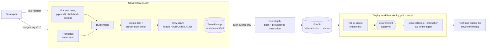

# Pulse

**Purpose:** a tiny, instrumented reference service for testing delivery platforms (in the spirit of podinfo). It has health and readiness probes, Prometheus metrics, tunable CPU work and opt-in fault injection, and ships through a gated CI/CD pipeline.

A small FastAPI service, **pulse-api**, packaged as a hardened container. It ships with:
- a **GitHub Actions** pipeline that publishes an image only after the image passes every gate: lint, unit tests, secret scan, container smoke test and vulnerability scan;
- an **approval-gated promotion workflow** with a one-step rollback.

The same image is the workload for [pulse-helm](https://github.com/SammamMahdi/pulse-helm) and [pulse-observability](https://github.com/SammamMahdi/pulse-observability).

**Why it matters:** "it builds" is not a release process. This repo shows the controls a delivery pipeline needs:
- tests that block merges;
- an image published only from trusted events, the exact artefact that was tested;
- a human approval before an environment changes;
- a rollback that does not require rebuilding anything.

## Architecture



## The service

| Endpoint | Purpose |
|---|---|
| `GET /health` | **Liveness.** The process can serve HTTP. It deliberately checks no dependencies, so a database outage cannot make Kubernetes restart healthy pods. |
| `GET /ready` | **Readiness.** Returns 503 while the app is starting or shutting down, so load balancers stop routing to it before SIGTERM handling finishes. |
| `GET /metrics` | Prometheus metrics: `http_requests_total{method,route,status}`, `http_request_duration_seconds` histogram, `http_requests_in_progress`, `app_ready`, `app_info{version,environment}`. |
| `GET /api/v1/info` | Version, environment and hostname. The hostname is the pod name in Kubernetes, which makes load balancing and rolling updates visible. |
| `GET /api/v1/primes/{n}` | Stateless functional endpoint: counts primes ≤ n with a sieve. Input is validated (422 for n < 0 or n > `MAX_PRIME_LIMIT`). The CPU cost can be tuned, which is useful for load tests. |
| `GET/PUT/DELETE /admin/faults` | Lab-only fault injection (latency, HTTP 500s, forced not-ready). **Absent unless `FAULT_INJECTION_ENABLED=true`.** Requires `X-Admin-Token`. |

Logs are JSON lines on stdout: one access log per request, with a request ID echoed in `X-Request-ID`. Probe and scrape requests are logged at DEBUG level to keep the logs readable.

### Configuration (environment variables)

| Variable | Default | Notes |
|---|---|---|
| `APP_ENV` | `local` | Reported in `/api/v1/info` and the `app_info` metric |
| `APP_VERSION` | set at build time | Docker build-arg baked into the image |
| `LOG_LEVEL` | `INFO` | `DEBUG`/`INFO`/`WARNING`/`ERROR`/`CRITICAL` |
| `MAX_PRIME_LIMIT` | `1000000` | 1 to 10,000,000 |
| `FAULT_INJECTION_ENABLED` | `false` | Lab only |
| `ADMIN_TOKEN` | unset | Required (≥16 chars) when fault injection is enabled; inject it as a secret |

Invalid values stop the process at startup with a clear message, for example `ConfigError: MAX_PRIME_LIMIT must be an integer, got 'abc'`. A misconfigured release therefore fails its health checks instead of serving traffic with surprising behaviour.

## Prerequisites

You need one of the following:
- Windows 11 with **WSL2** (Ubuntu 24.04) and Docker Engine, or Docker Desktop;
- any Linux machine with Docker 24+ and the Compose plugin.

Python 3.12 is needed only to run the unit tests outside Docker.

## Quick start

```bash
docker compose up --build -d          # builds pulse-api:local, waits for the HEALTHCHECK
curl -s http://127.0.0.1:8000/health          # {"status":"ok"}
curl -s http://127.0.0.1:8000/api/v1/primes/100   # {"n":100,"prime_count":25,"largest_prime":97}
docker compose logs api | tail -3     # JSON access logs
```

The port is bound to `127.0.0.1` only. The container runs read-only as UID 10001 with all Linux capabilities dropped and `no-new-privileges` set.

## Run the checks locally

```bash
python3 -m venv .venv && . .venv/bin/activate
pip install -r requirements-dev.txt
ruff check . && ruff format --check .
pytest --cov                     # 46 tests, coverage gate 90%
pip-audit -r requirements.txt
docker build --build-arg APP_VERSION=1.0.0 -t pulse-api:1.0.0 .
scripts/smoke-test.sh pulse-api:1.0.0                                     # must PASS
SMOKE_ENV="MAX_PRIME_LIMIT=oops" scripts/smoke-test.sh pulse-api:1.0.0    # must FAIL (detects broken start)
trivy image --severity HIGH,CRITICAL --ignore-unfixed --exit-code 1 pulse-api:1.0.0
```

`tests/test_workflow_policy.py` checks the pipeline's security properties as code:
- read-only default token;
- SHA-pinned actions;
- no persisted git credentials;
- publishing only on `push`;
- `packages: write` only on the publish job;
- promotion gated by an environment.

## CI/CD pipeline

| Event | test | secret-scan | build (smoke + scan) | publish | deploy |
|---|---|---|---|---|---|
| Pull request (including forks) | ✔ | ✔ | ✔ | **skipped** (`if: github.event_name == 'push'`) | n/a |
| Push to `main` | ✔ | ✔ | ✔ | ✔ `sha-<short>`, `main` | manual |
| Tag `v1.2.3` | ✔ | ✔ | ✔ | ✔ `1.2.3`, `sha-<short>` | manual |

- **The published image is the tested image.** The build job saves the image that passed the smoke test and the scan (`docker save`). The publish job loads that artefact and pushes it. It does not rebuild.
- **Promotion is by digest, not by tag.** `deploy.yml` takes an immutable `sha256:` digest:
  - It re-runs the smoke test against the image pulled by digest.
  - It then waits for **environment approval** (required reviewers configured on the `staging`/`production` environments).
  - Finally it moves the environment tag. The job summary records the previous digest for rollback.

[docs/cicd-concepts.md](docs/cicd-concepts.md) explains continuous integration, continuous delivery and continuous deployment, and which one this repo implements: **continuous integration plus continuous delivery**, with deployment gated by approval.

### Repository settings to enable after pushing to GitHub

These settings live in the GitHub UI, not in code:
1. **Settings → Environments:** create `staging` and `production`, and add required reviewers to `production`.
2. **Settings → Branches:** protect `main` and require the status checks "Lint and unit tests", "Secret scan (TruffleHog)" and "Build, smoke test and scan image".
3. **Settings → Actions → General:** set workflow permissions to "Read repository contents".

## Rollback

There are two layers of rollback, and neither rebuilds anything:
- **Registry/environment:** re-run *Deploy (promote image)* with the previous digest printed in the last deployment's summary.
- **Local Compose:** `TAG=<previous> docker compose up -d --no-build --wait`. `scripts/rollback-demo.sh 1.0.0 1.1.0` deploys 1.0.0, then 1.1.0, then rolls back to 1.0.0 and verifies the running version and readiness.

See [docs/rollback.md](docs/rollback.md).

## Design choices

- **Multi-stage build:** dependencies are installed into a venv in the builder stage, and pip is removed from the runtime venv. The runtime image is 202 MB on `python:3.12-slim`.
- **Base image pinned by digest:** builds are reproducible, and Dependabot proposes digest bumps weekly.
- **App code owned by root and read-only to UID 10001:** a compromised process cannot rewrite its own code.
- **One Uvicorn worker per container:** scaling is done with replicas. This keeps per-process state (metrics, fault settings) simple, and Kubernetes or Compose handle restarts.
- **Metric labels use the route template** (`/api/v1/primes/{n}`), never the raw path. Raw paths would create one time series per URL (unbounded cardinality).
- **Liveness ≠ readiness:** liveness never depends on downstream systems, and readiness is withdrawn first on shutdown.
- **Fully pinned dependencies** (direct and transitive) are generated by `scripts/lock-deps.sh` and audited with pip-audit.

## Security considerations

- Default `GITHUB_TOKEN` permission is `contents: read`. Only the publish job gets `packages: write`, `id-token: write` and `attestations: write`. Pull requests can never publish.
- Every third-party action is pinned to a full commit SHA. Dependabot updates the pins after a 14-day cooldown. See [docs/third-party-tooling.md](docs/third-party-tooling.md) for why this matters, including the March 2026 Trivy supply-chain incident.
- Workflow inputs reach shell scripts only through `env:`, never through `${{ }}` interpolation inside `run:`, which prevents script injection. The deploy workflow also validates the digest format.
- Build provenance is attested (`actions/attest-build-provenance`) for every published digest.
- Trivy fails the build on **fixable** HIGH/CRITICAL vulnerabilities. Unfixed OS-package CVEs are reported but do not block, because no patched package exists yet. This is a deliberate trade-off, revisited when the base image is updated.
- The fault-injection API does not exist unless explicitly enabled. When it is enabled, it needs a token of at least 16 characters, compared in constant time.

## Troubleshooting

| Symptom | Check |
|---|---|
| Container exits immediately | Run `docker logs <container>`. A `ConfigError` names the bad variable. |
| `unhealthy` in `docker ps` | Run `docker inspect --format '{{json .State.Health}}' <container>` to see the last 5 probe outputs. |
| `curl: connection refused` from another machine | Expected: Compose binds to 127.0.0.1. Change `ports` only if you mean to expose it. |
| CI "Broken startup must be detected" fails | The smoke test no longer notices a crashing container. Fix `scripts/smoke-test.sh`, not the test. |
| Trivy job fails | Read the table. Bump the base image digest or the dependency named there, and re-run. |
| Publish job skipped | Expected on pull requests and manual runs. Publishing happens only on pushes to `main` or `v*` tags. |

## Cleanup

```bash
docker compose down --remove-orphans
docker image rm pulse-api:local pulse-api:1.0.0 pulse-api:1.1.0
```

## Verification evidence

All of this was executed on 2026-10-10 on Windows 11 with WSL2 (Ubuntu 24.04) and Docker Engine 29.8.1. Full excerpts are in [docs/verification.md](docs/verification.md).

| Requirement | Status |
|---|---|
| Unit tests (46, coverage 97.5%), ruff, pip-audit, hadolint, shellcheck, actionlint | Executed successfully |
| Image runs non-root, healthcheck passes, all endpoints respond | Executed successfully (smoke test) |
| Broken container startup is detected | Executed successfully (smoke test fails on bad config, as required) |
| Deliberately failing test blocks the pipeline | Executed successfully, **locally with `act`**: an injected off-by-one bug failed 5 tests and the build job never started |
| Trivy gate (no fixable HIGH/CRITICAL) | Executed successfully (Trivy 0.74.0). Inside `act`, the Trivy action could not run because act provides no `github.token`. |
| Pipeline policy (publish only on push, SHA pins, scoped permissions) | Executed successfully (policy tests; all 5 deliberate weakenings were caught) |
| Secret scan | Executed successfully (TruffleHog 3.97.9: 0 findings) |
| Compose deploy + rollback | Executed successfully (1.0.0 → 1.1.0 → 1.0.0, healthy) |
| PR CI on GitHub-hosted runners, GHCR publish, environment approval | **Not yet executed:** the repository has not been pushed to GitHub. The workflows are statically validated with actionlint and the policy tests. |

## Limitations and future improvements

- GitHub-hosted runs, GHCR publishing and environment approvals will be demonstrated once the repo is pushed. Until then the pipeline has been exercised locally with `act`, which is not identical to GitHub's runners.
- The "deployment" moves an environment tag in the registry. The runtime that consumes it (the Helm chart in pulse-helm) is a separate project. A GitOps controller such as Argo CD would make that hand-off pull-based.
- Fixable-only vulnerability gating leaves known-unfixed CVEs in the base OS layer. A distroless or Chainguard base would shrink that surface.
- Future additions: SBOM publication (CycloneDX), image signing with cosign, and a SAST stage.

## License

MIT, see [LICENSE](LICENSE).
